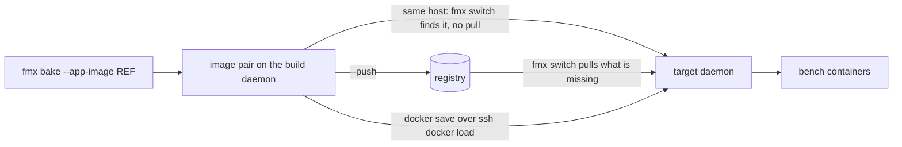

# Transports and platforms

## Transports: getting the image to where it runs

A deploy is two commands, run on the host that owns the bench:

```bash
fmx bake mybench --app-image ghcr.io/acme/mybench:v42 --push
fmx switch mybench ghcr.io/acme/mybench:v42
```

`--app-image` names the app image the bake produces, and it takes either form. Give it a **full image ref** and it's built exactly as typed: the image you switch to is the image you typed, and nothing has to be read back out of the bake output. Give it a **bare repo** and the bake generates `<repo>:<timestamp>-<git sha>` and prints it, which you then pass to `fmx switch`. Omitting `--app-image` altogether falls back to the bench's own `image` repo the same way. What the image is built *from* is a separate input, `--base-image` (persisted as `[build].base_image`), and it's never the thing you switch onto.

Whether anything has to be transported at all depends on where those two commands run.



**Same host, the single-server case.** `fmx switch` begins by making sure both images are on the daemon it talks to, and returns immediately when they already are. A bake on that same machine has just put them there, so the switch never pulls and you need no registry at all: skip `--push`, and an `image = "local/mybench"` repo is enough.

**Bake here, run there.** Now the image has to cross the gap. There's no mode to select: `fmx switch` asks the target daemon whether each image is already there, and pulls only what's missing. You choose by how you get the image across, not by a config value.

Via a registry, which is the normal path:

```toml
[build]
push = true                  # or pass --push on the command line
```

`fmx bake --push` (or `[build] push = true`) publishes both images, and `fmx switch` on the target pulls whatever it doesn't already have. The registry host is part of the image ref itself (`image = "ghcr.io/acme/mybench"`), so there's nothing else to configure.

**Authentication is docker's, not fmx's.** A private registry needs one `docker login` on each machine that pushes or pulls, or a login step in CI. That's all: `~/.docker/config.json` already stores credentials per registry, and supports credential helpers (osxkeychain, `pass`, `ecr-login`) that fmx has no way to reach. fmx holds no registry credentials of its own, and never did anything with them beyond running `docker login` for you, which is why the `[registry]` table was removed in 1.0.0. A bench that still carries one loads fine, and the 1.0.0 migration strips it.

If a pull fails, fmx says which of the two things is wrong. It can't ask the registry whether you're authenticated, but `docker login` records the host in `~/.docker/config.json` even when the secret lives in a helper, so fmx checks there and leads with the likely cause:

```
Could not pull ghcr.io/acme/mybench:v42: no docker login for ghcr.io was found. If that
image is private, run `docker login ghcr.io` here and retry: fmx uses the daemon's own
credentials and holds none itself. The registry said: manifest unknown
```

That matters because registries disagree about how they refuse an anonymous request for a private image. Docker Hub says `pull access denied ... may require 'docker login'`. GHCR says `manifest unknown`, indistinguishable from an image that was never pushed, so the raw message sends you hunting through the registry UI for a bad image when the answer is a login. When you *are* logged in to that host, the same failure instead points at the image and at `fmx bake --push`.

Or by hand, for an airgapped target with no registry at all:

```bash
docker save ghcr.io/acme/mybench:v42 ghcr.io/acme/mybench-nginx:v42 | ssh prod docker load
ssh prod "fmx switch mybench ghcr.io/acme/mybench:v42"
```

The presence check is what makes this work: the images are already on the target daemon, so the switch uses them and never contacts a registry. Skip the transport, and the pull that follows is what fails, naming the image it couldn't get.

Either way you're moving a **pair** of images. Every bake builds the app image and its paired `-nginx` assets image, named by default (same tag, `-nginx` appended to the repo) or explicitly via `--nginx-image`, and bake stamps the pairing as an `fm.nginx.image` label on the app image. Both are what `fmx switch` fetches, deploys and prunes together. That's why the `docker save` above names two images.

## Platforms (CPU architectures)

Images are architecture-specific, and a bake has to target the architecture the image will *run* on, not necessarily the one it builds on. fmx resolves the bake target as:

1. [`[build].platform`](../reference/configuration.md#deploy-tables) if set,
2. else the build daemon's native arch.

So when the machine you bake on and the machine you run on differ, an Apple Silicon laptop building for an amd64 server, set `[build].platform = "linux/amd64"` explicitly. Nothing detects the target for you.

Cross-arch bakes require emulation (Rosetta or binfmt; Docker Desktop ships it) and only work with `[build].source = "provision"` (a `workspace` snapshot contains host-arch binaries, so fmx refuses it). The two image builds run as `docker buildx build --platform <target> --load`; the provisioning containers that run before them take no platform argument, so they're steered by `DOCKER_DEFAULT_PLATFORM` for the duration of the bake. Before provisioning starts, fmx checks the **base image** the bake builds from (`fmx bake --base-image REF`, or `[build].base_image`, defaulting to fmx's published base) against the target architecture: a local copy of the right arch passes, and fmx fails fast with the list of published architectures when the registry manifest provably lacks it.

`[build].platform` names exactly one platform. fmx loads each built image into the local daemon, which is what lets the pre-flight boot check run it and a same-host `fmx switch` skip the registry, and docker can't load a multi-platform manifest list. A comma-separated value is refused rather than attempted. If you need a manifest list covering several architectures, push one yourself from a container-driver buildx builder.

## Running fmx in CI

fmx has no special host requirements: it runs anywhere Docker and your SSH keys exist, including a CI runner. For GitHub Actions there's an action in this repository that wraps the two commands below; the raw shape is worth reading first, because the action is only those commands with the arguments filled in.

The shape is the same two commands, split across two machines. Bake and push on the runner, then run the switch on the server that owns the bench:

```bash
# on the runner: no bench needed, just the app list and a ref you chose
fmx bake --apps frappe --apps erpnext:version-16 --app-image ghcr.io/acme/mybench:$GIT_SHA --push

# on the server that owns the bench
ssh prod "fmx switch mybench ghcr.io/acme/mybench:$GIT_SHA"
```

Because you picked the ref up front, the two halves need nothing from each other but that string: no output parsing, no handoff file.

The bench-less bake (`--apps` or `--config` with no bench name) builds and pushes without any bench, compose project or site on the runner, so the runner needs Docker and a registry login and nothing else. The switch half has to run where the bench lives: it rewrites that bench's `bench_config.toml` and `docker-compose.yml`, drains its workers, dumps its database into the bench's `backups/` directory and moves its traffic. All of that is local filesystem and local daemon work, which is why the target runs fmx itself over plain SSH.

### The GitHub Action

`rtCamp/Frappe-Manager` ships an `action.yml` that runs exactly those two halves. `phase` picks which: `bake`, `switch`, or `both`.

```yaml
- uses: rtCamp/Frappe-Manager@main
  with:
    phase: both
    image: ghcr.io/acme/mybench
    apps: |
      frappe
      erpnext:version-16
    push: true
    registry-username: ${{ github.actor }}
    registry-password: ${{ secrets.GITHUB_TOKEN }}
    bench: mybench
    ssh-host: prod.example.com
    ssh-user: deploy
    ssh-key: ${{ secrets.DEPLOY_KEY }}
```

`image` is the repository, and `tag` is separate, defaulting to the short commit sha. The action composes them, so it always knows the exact ref and never reads it back out of fmx's output. The ref it shipped is available afterwards as the `image` output.

It installs fmx on the runner from a **git ref**, not PyPI, because the released version predates the current bake and switch surface. `fmx-version` takes any branch, tag or sha, and the `FM_VERSION` environment variable overrides it without editing the workflow.

On the **switch target** it installs nothing. fmx has to be there already, and the action finds it rather than assuming a PATH: `ssh host "fmx ..."` runs a non-interactive shell, which reads neither `.bashrc` nor `.profile`, so an fmx installed by `uv tool install` into `~/.local/bin` is invisible to a bare `fmx`. The action looks on PATH, then at `~/.local/bin/fm`, `/usr/local/bin/fm` and `/usr/bin/fm`, then runs `--version` on what it found, because a half-finished install still leaves the shim behind. `fmx-remote-path` names it explicitly when it lives somewhere else.

That check runs **before the bake**, deliberately. A bake is minutes of build plus a registry push, and finding out afterwards that the switch can't start wastes all of it and leaves a pushed image nothing is going to deploy.

Overlays reach the bake two ways, and they compose in this order: `config-files` (paths in your checked-out repo, one per line, later files winning) then `config` (a single path, or the TOML itself inline). Paths are relative to the workspace, so the job needs `actions/checkout` first, and a missing file is reported rather than silently skipped.

```yaml
- uses: rtCamp/Frappe-Manager@main
  with:
    phase: bake
    image: ghcr.io/acme/mybench
    config-files: |
      ci/base.toml
      ci/prod.toml
    config: |
      [build]
      source = "provision"
```

#### Secrets in a committed config

Every overlay the action passes is run through `FM_ACTION_*` environment expansion first, so a config file can live in the repo while its secrets live in the environment:

```toml
# ci/prod.toml, committed
[build]
base_image = "ghcr.io/acme/frappe-private:${FM_ACTION_BASE_TAG}"
```

```yaml
- uses: rtCamp/Frappe-Manager@main
  env:
    FM_ACTION_BASE_TAG: ${{ vars.BASE_TAG }}
  with:
    image: ghcr.io/acme/mybench
    config-files: ci/prod.toml
```

Three rules, each deliberate:

- Only names starting with `FM_ACTION_` are substituted, so a `$HOME` or `$PATH` inside a config value stays exactly as written.
- A referenced `FM_ACTION_*` variable that isn't set is an **error**, not an empty string and not the literal text: a typo that survives as a literal password fails much later and much more confusingly.
- Only the variable **names** are logged, never the values.

Shell default syntax like `${FM_ACTION_TOKEN:-fallback}` is refused rather than passed through, since silently forwarding it would look like it worked. The expanded result is written to a mode-600 file and fmx is given the path, so the secret never appears in a command line where other processes could read it.

This is a CI-layer feature, not a config-file feature: fmx itself doesn't expand these. Doing it at load time would write the plaintext straight back out, because `export_to_toml` builds from the model, and normal operation rewrites `bench_config.toml` from dozens of call sites.

Set `platform` when the runner and the server differ in architecture, since nothing detects the target for you. Set `ssh-known-hosts` to pin the host key; left empty, the action falls back to `ssh-keyscan`, which trusts whatever answers on the first connection.
