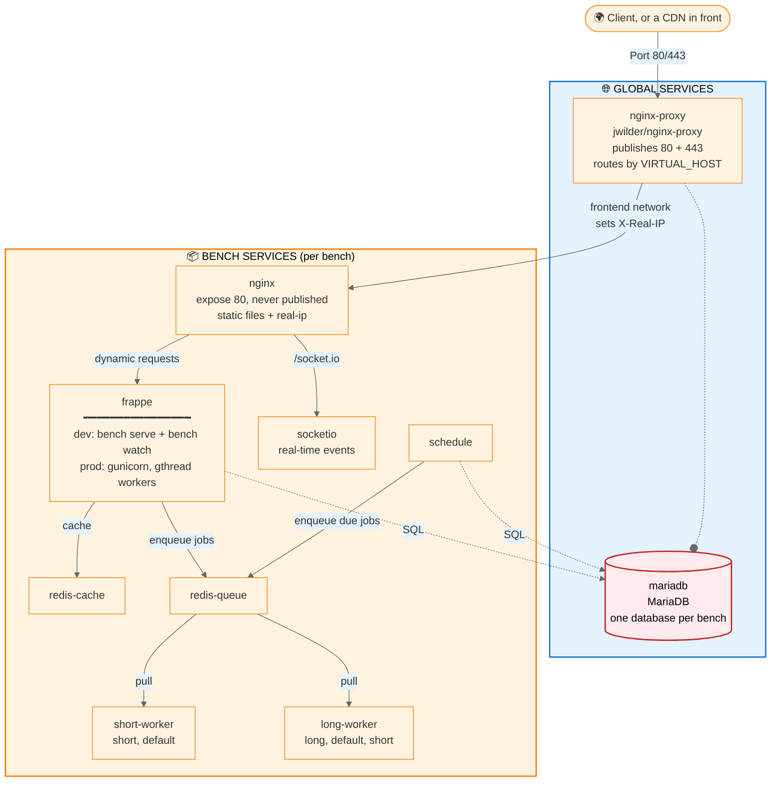

# Architecture

How fmx's containers, networks and volumes fit together, and the path a request takes to reach your code.

## Two tiers of containers, two runtimes

fmx's containers split into two tiers:

1. **Global services**, shared once per machine: MariaDB (`mariadb`) and Postgres (`postgres`), each started only once some bench actually uses that engine, and a `jwilder/nginx-proxy` (`nginx-proxy`) that owns ports 80 and 443.
2. **Per-bench services**, one stack per bench: the frappe web container, its own nginx, socketio, the scheduler, two Redis instances, the RQ worker containers and (optionally) admin tools.

Many benches share one host, fmx's database servers and one proxy.

Orthogonally, each bench runs in one of two **runtimes** ([`runtime`](configuration.md#runtime) in `bench_config.toml`):

- **`mount`** (default): app code lives on the host in `workspace/frappe-bench/` and is live-mounted into the containers. Editable; built for development.
- **`image`**: app code is baked into an immutable image (`fmx bake`) and deploys happen by switching images (`fmx switch`). Only mutable data is bound in from the workspace: the site directory, `common_site_config.json`, `apps.txt`, `logs` and `config`.

The topology below is identical in both runtimes; only where the app code comes from differs. See the [Deployment guide](../deploy/index.md).

!!! tip "Quick navigation"
    Jump to: [The request path](#request-path) · [Workspace layout](#workspace-layout) · [Global services](#global-services) · [Per-bench services](#per-bench-services) · [Networks](#networks) · [Volumes](#volumes)

### Service architecture diagram



Only the `frappe` container differs between environments:

- **dev:** `bench serve` (Werkzeug, one process with a thread per request, no worker pool) plus `bench watch` for asset hot-reload.
- **prod:** gunicorn with `gthread` workers, sized automatically. See [Web serving and concurrency](../concepts/web-serving.md#gunicorn-workers-and-threads).

---

## The request path {#request-path}

Every request crosses the same hops, and each one changes something that the next hop depends on.

```
client (or CDN edge)
  → nginx-proxy               published :80/:443, TLS terminates here
  → bench nginx               on fm-frontend-network, :80 exposed only
  → gunicorn / bench serve    or socketio for /socket.io
```

1. **The global proxy** is the only fmx container that publishes host ports. It reads the `Host:` header and picks the bench whose nginx carries a matching `VIRTUAL_HOST` (fmx sets it to the bench's primary domain plus every `alias_domains` entry). It terminates TLS using the certs under `services/nginx-proxy/certs/`.
2. **The bench's nginx** serves `/assets` and public site files as static files, proxies `/socket.io` to the `socketio` container, and sends everything else to the web process as `@webserver`. Admin tools, when enabled, are proxied from `/mailpit/` and `/adminer/` here too.
3. **The web process** is gunicorn in prod and `bench serve` in dev, both on port 80 inside the container.

!!! warning "The `/assets` fallthrough is a dev-only safety net"
    `/assets` is `try_files $uri @webserver`, so a bundle nginx cannot find is retried against the web process. That recovers the file only in `dev`: frappe wraps its app in `application_with_statics()` inside `serve()`, whereas prod runs `gunicorn frappe.app:application`, the bare module-level app with no static middleware. In prod the miss is a hard 404, and where nginx was looking depends on the runtime:

    - **`mount`:** the stock `-nginx` image plus the single `./workspace:/workspace` bind, so nginx reads `/workspace/frappe-bench/sites/assets` live off the host. A missing bundle means the bench has not built it; rebuild it in the bench.
    - **`image`:** the baked `<repo>-nginx:<tag>` image (`Docker/nginx/Dockerfile`, the `app-assets` stage), and the image-mode binds deliberately cover only `sites/<site>`, `common_site_config.json`, `apps.txt`, `logs` and `config`, never `sites/assets`, so nothing masks the baked bundles. A missing bundle needs a rebake.

### The frontend network is the only way in {#frontend-network}

Bench nginx declares `expose: 80`, never `ports:`. Nothing about a bench is reachable from the host or the LAN; the only route in is the shared `fm-frontend-network` that the global proxy also sits on.

Both shared networks get a `/16` in `10.0.0.0/8`, chosen the same way: fmx reuses the subnet of a same-named network that is already running (from a previous install, say), and otherwise picks the first free `10.x.0.0/16`, preferring `10.1.0.0/16` for the frontend and a different free range for the backend once the frontend's is taken. Each choice is made once and persisted in `fm_config.toml`: the frontend as [`network.subnet_cidr`](configuration.md#network) and the proxy's static address as `network.proxy_ip`, the backend as `network.backend_subnet_cidr`. Both are written into the services compose file.

!!! note "Containers resolve their own domain to the proxy"
    `frappe`, `socketio` and `schedule` get `extra_hosts` entries mapping the bench's domains to the proxy's frontend-network IP. An outbound HTTP call from inside the bench to its own site therefore travels the full chain rather than short-circuiting, so it sees the same nginx rules and the same TLS as an external visitor.

### Restoring the visitor's IP {#real-ip}

Because every request reaches bench nginx from the proxy's own frontend-network address, `$remote_addr` there would otherwise be the proxy for the entire internet, and frappe's `request_ip`, its per-IP rate limiting and the Activity Log would see one address for every visitor.

fmx fixes this in two halves:

- **Bench nginx** gets an fmx-generated `configs/nginx/conf/custom/real-ip.conf` containing `set_real_ip_from <frontend subnet>;` and `real_ip_header X-Real-IP;`. The frontend network being the only route in is what makes trusting that whole subnet safe. The file is regenerated whenever the compose file is regenerated and on every `fmx start`, so a bench never boots without it once the subnet is known.
- **The global proxy** needs the same treatment only when something else sits in front of it. `fmx services trusted-proxies set --cdn cloudflare` (or `--trust <CIDR>`, repeatable) writes the trusted ranges and the header to read into the proxy's `conf.d`. Without it, a CDN's edge address is what the proxy calls the client, and that is what it forwards on.

The same trusted set now decides two more things, not only the logged address: the scheme fmx's HTTP-to-HTTPS redirect believes a visitor arrived on, and whether gunicorn trusts a forwarded scheme at all (`TRUST_DOWNSTREAM_PROXY`). A `geo`/`map` pair in the proxy's `conf.d` resolves `$fm_client_scheme` per request from the connecting peer, using the forwarded value for a peer in the trusted set and the scheme of the connection fmx actually received for everyone else, so a forged header from an untrusted address changes nothing. See [Web serving: HTTPS and the client's address](../concepts/web-serving.md#https-and-the-clients-address) for the full chain and its one residual gap.

```bash
# Trust Cloudflare's published ranges, reading the client from CF-Connecting-IP
fmx services trusted-proxies set --cdn cloudflare

# Trust your own load balancer instead (X-Forwarded-For by default)
fmx services trusted-proxies set --trust 203.0.113.0/24

# Show what is trusted right now
fmx services trusted-proxies status
```

!!! warning "Trust only what you actually sit behind"
    Whatever the proxy trusts fully controls the client IP that fmx, your logs and frappe go on to see, and now the scheme its redirect and gunicorn believe too. Each `set` replaces the whole trusted set, so pass every range you sit behind in one call; `fmx services trusted-proxies clear` returns to trusting nothing, which behind a front that still forwards plain HTTP means an immediate redirect loop.

### Why a TLS-terminating CDN does not loop {#https-method}

fmx pins `HTTPS_METHOD=noredirect` on every bench nginx container. `jwilder/nginx-proxy` would otherwise 301 plain HTTP to HTTPS; behind a CDN that terminates TLS and forwards HTTP to the origin, that redirect is what produces a redirect loop. With `noredirect` the proxy serves both schemes and leaves the redirect decision to the edge.

Per-domain HTTP-to-HTTPS redirects that fmx *does* want live in `services/nginx-proxy/vhostd/<domain>`, written by `fmx ssl add`.

---

## Workspace layout {#workspace-layout}

fmx keeps everything under a single root directory (default `~/frappe/`).

!!! info "Relocate with an environment variable"
    Set `FRAPPE_MANAGER_HOME` before any fmx command to use a custom location:
    ```bash
    export FRAPPE_MANAGER_HOME=/srv/frappe
    ```

<div class="annotate" markdown>

```tree title="~/frappe/ (Frappe Manager root)"
~/frappe/
│
├── 📄 fm_config.toml                    # (1)
│
├── 📁 logs/
│   └── fm.log                           # (2)
│
├── 📁 backups/
│   └── migrations/
│       └── 12-Apr-26--14-30-45/         # (3)
│
├── 📁 archived/                         # (4)
│
├── 📁 services/                         # (5)
│   ├── docker-compose.yml
│   ├── secrets/                         # (6)
│   ├── mariadb/
│   │   ├── conf/
│   │   └── data/                        # (7)
│   └── nginx-proxy/
│       ├── ssl/
│       │   ├── acmesh/
│       │   │   ├── .acme.sh/            # (8)
│       │   │   └── example.com/
│       │   │       ├── fullchain.pem
│       │   │       └── key.pem
│       │   └── custom/
│       │       └── byo.example.com/     # key.pem, fullchain.pem, ca.pem
│       ├── certs/                       # (9)
│       │   ├── example.com.crt → /usr/share/nginx/ssl/acmesh/example.com/fullchain.pem
│       │   └── example.com.key → /usr/share/nginx/ssl/acmesh/example.com/key.pem
│       ├── vhostd/                      # (10)
│       │   └── example.com
│       └── confd/                       # (11)
│
└── 📁 sites/                            # (12)
    ├── mybench.localhost/
    │   ├── 📄 bench_config.toml         # (13)
    │   ├── docker-compose.yml           # (14)
    │   ├── docker-compose.workers.yml
    │   ├── docker-compose.admin-tools.yml
    │   ├── backups/
    │   │   └── migrations/              # (15)
    │   ├── configs/                     # (16)
    │   │   ├── adminer/
    │   │   └── nginx/
    │   │       ├── conf/
    │   │       │   ├── conf.d/default.conf     # (17)
    │   │       │   ├── custom/real-ip.conf     # (18)
    │   │       │   └── http_auth/              # (19)
    │   │       └── logs/                # (20)
    │   └── workspace/
    │       └── frappe-bench/            # (21)
    │           ├── apps/                # (22)
    │           │   ├── frappe/
    │           │   ├── erpnext/
    │           │   └── custom_app/
    │           ├── sites/               # (23)
    │           │   ├── apps.txt
    │           │   ├── common_site_config.json
    │           │   ├── currentsite.txt
    │           │   └── mybench.localhost/
    │           │       └── site_config.json
    │           ├── logs/                # (24)
    │           │   ├── web.log
    │           │   ├── web.error.log
    │           │   ├── web.dev.log
    │           │   ├── worker.log
    │           │   └── schedule.log
    │           ├── config/              # (25)
    │           └── env/                 # (26)
    │
    └── prod.example.com/
        └── ... (same structure)
```

</div>

1. **Global configuration**: machine-wide fmx settings (ngrok token, DNS credentials, log level, frontend network addressing).
2. **CLI operation log**: everything every `fmx` command did. Rotates at 10 MiB, keeping `fm.log.1.gz` to `fm.log.3.gz`.
3. **Migration backups**: one directory per migration session, named `%d-%b-%y--%H-%M-%S`, with a per-bench subdirectory inside.
4. **Archived benches**: benches moved aside by `fmx migrate --on-failure=archive`.
5. **Global services**: the `mariadb` and `nginx-proxy` stack.
6. **Database secrets**: `db_password.txt` and `db_root_password.txt`, mounted into `mariadb` as Docker secrets.
7. **MariaDB data**: Linux only. macOS uses the named volume `fm-mariadb-data` to avoid bind-mount slowness.
8. **acme.sh installation**: the certificate automation tool and its state.
9. **Certificate symlinks**: what `nginx-proxy` actually reads. Each link's target is a container path (the proxy mounts `ssl/` at `/usr/share/nginx/ssl`), pointing at the real files in `ssl/acmesh/<domain>/`, `ssl/dev/<domain>/` or `ssl/custom/<domain>/`.
10. **Per-domain vhost snippets**: the HTTP-to-HTTPS redirects written by `fmx ssl add`.
11. **Global nginx `conf.d`**: fmx's own snippets (the `fmx services trusted-proxies` config, `fm_headers.conf`, and `fm-forwarded-trust.conf`, always present, defining `$fm_client_scheme` and `$fm_https_suffix`, regenerated by fmx) plus custom server blocks for non-fmx Docker projects.
12. **All benches**: one subdirectory per bench.
13. **Bench configuration**: environment, runtime, SSL, upload limit, restart policy, auth, worker care.
14. **Compose files**: the layered core, workers and admin-tools stacks.
15. **Bench migration backups**: `bench_config.toml`, compose files and a gzipped DB dump per migration session.
16. **fmx-managed container config**: bind-mounted into the bench's nginx and adminer containers.
17. **Bench nginx server block**: rendered from the site map; do not hand-edit, `fmx` regenerates it.
18. **Real client IP restoration**: generated by fmx, refreshed on every `fmx start`.
19. **Basic auth**: the htpasswd file backing `fmx auth`.
20. **Bench nginx logs**: the structured JSON access log and the error log.
21. **Frappe workspace**: the standard bench directory layout.
22. **Installed apps**: frappe, erpnext and your own. Live-mounted in `mount` runtime, baked into the image in `image` runtime.
23. **Site files**: frappe site configuration and data.
24. **Application logs**: web, worker and scheduler output. See [Logs and debugging](logs.md).
25. **Process config**: the split `*.fm.supervisor.conf` files fmx generates, plus the `fm-web-server.sh` gunicorn wrapper.
26. **Python virtualenv**: this bench's packages.

!!! warning "Do not edit workspace files directly"
    Files under `workspace/frappe-bench/` belong to frappe and bench. Use `fmx shell` and `bench` commands instead.

---

## Global services

Shared by every bench on the host. `nginx-proxy` starts once, at install, and stays up. `mariadb` and `postgres` only start once some bench on the host actually uses that engine, and fmx removes the container again if nothing does, so a host with no Postgres site never runs one.

`mariadb`, `postgres` and `nginx-proxy` are all pinned by digest, not just a tag: the exact bytes a host runs are decided by the fmx release it installed, not by whatever a floating tag happens to resolve to on the day something pulls it. A `docker pull` here is a no-op until an fmx upgrade re-renders the compose file onto a new pin; `fmx self update-images --check` reports when a pin has moved in the registry, without pulling it.

### `mariadb` {#mariadb}

`mariadb:11.8`, reachable on 3306 over the backend network only: it publishes no host port.

Each bench gets its own database in this one server, named `fm_<benchname>_<16 hex chars>`, with a dedicated user scoped to it. Passwords are generated on setup and mounted as Docker secrets from `services/secrets/`.

Storage is a bind mount at `services/mariadb/data/` on Linux and the named volume `fm-mariadb-data` on macOS. The server runs with `utf8mb4` defaults and `--skip-character-set-client-handshake`, and `MARIADB_AUTO_UPGRADE` runs `mariadb-upgrade` when the engine version changes.

```bash
# Shell into the database server
fmx services shell mariadb

# Open a bench's own database
fmx shell mybench -c "bench mariadb"
```

A bench can be pointed at an external server instead; see the [external database guide](../guides/external-database.md).

### `postgres` {#postgres}

`postgres:18`, reachable on 5432 over the backend network only: it publishes no host port.

Each bench on Postgres gets its own database and role in this one server. Storage is a bind mount at `services/postgres/data/`. Unlike MariaDB, Postgres has no automatic major-version upgrade: a datadir written by one major refuses to start under the next, so fmx refuses to start the container rather than let it crash-loop, and moving majors needs a dump and restore.

```bash
# Shell into the database server
fmx services shell postgres
```

A bench can be pointed at an external server instead; see the [external database guide](../guides/external-database.md).

### `nginx-proxy` {#nginx-proxy}

`jwilder/nginx-proxy:1.11`, publishing 80 and 443. It watches the Docker socket, discovers each bench nginx by its `VIRTUAL_HOST` environment variable and routes by `Host:` header. It enables HTTPS for a domain as soon as `<domain>.crt` and `<domain>.key` appear in `services/nginx-proxy/certs/`.

Access logs use the same JSON format as bench nginx, so both hops feed one ingestion pipeline.

**See also:** [HTTPS certificates](../guides/ssl.md), [Domains guide](../guides/domains.md), [`fmx ssl`](../commands/ssl.md).

---

## Per-bench services

Container names are prefixed `fm__<benchname>__`, with dots in the bench name replaced by underscores.

**Core stack** (`docker-compose.yml`): `frappe`, `nginx`, `socketio`, `schedule`, `redis-cache`, `redis-queue`. The frappe and nginx images are fmx's own; Redis is `redis:8-alpine`, pinned by digest the same way as the global services above.

**Workers** (`docker-compose.workers.yml`): one container per RQ queue, generated from the supervisor configs in the bench's `config/` directory rather than hard-coded. `short-worker` consumes `short,default` and `long-worker` consumes `long,default,short`, so a `default` job is picked up by whichever is free. Extra queues come from the `workers` key of `common_site_config.json`, each getting its own container. Each container runs `background_workers` RQ processes (default 1, also from `common_site_config.json`); see [Background jobs and workers](../concepts/background-jobs.md).

**Admin tools** (`docker-compose.admin-tools.yml`, only when [`admin_tools`](configuration.md#admin-tools) is true, off by default on every environment): mailpit at `/mailpit/` catching all outgoing mail, adminer at `/adminer/` for the database. Toggle with `fmx tools enable|disable <bench>`; see the [Admin Tools guide](../guides/admin-tools.md).

All of a bench's services start and stop together with `fmx start` and `fmx stop`. Auto-recovery after a daemon or host restart is governed by [`restart_policy`](configuration.md#restart-policy).

Inspect the effective stack, images and all, with:

```bash
fmx compose mybench config
fmx compose mybench ps
```

---

## Docker networks {#networks}

| Network | Scope | Carries |
|---------|-------|---------|
| `fm-frontend-network` | shared, external to the bench compose | `nginx`, `frappe`, `socketio`, `schedule` and the workers of **every** bench, plus `nginx-proxy`. The only route into a bench. |
| `fm-backend-network` | shared, external to the bench compose | `frappe`, `schedule`, the workers and `adminer` of every bench, plus `mariadb`. |
| `fm__<bench>__site-network` | one per bench | Every container of that bench, including Redis and mailpit, which are on nothing else. |

!!! warning "The shared networks are shared, not isolated"
    Both global networks span every bench on the host, so containers from different benches can reach each other on them. Only the per-bench `site-network` is private, which is why bench nginx upstreams resolve the network-scoped aliases `frappe-site` and `socketio-site`: the bare name `frappe` also resolves on the shared frontend network, where Docker DNS would round-robin across every bench's frappe container.

---

## Docker volumes {#volumes}

- `fm-mariadb-data`: MariaDB data on macOS. Linux bind-mounts `services/mariadb/data/` instead.
- `fm__<bench>__fm-sockets`: the supervisorctl unix socket, shared by every process container in the bench. This is what lets [`fmx`](../guides/fmx.md) drive supervisor from any of them.
- `fm__<bench>__redis-cache-data`, `fm__<bench>__redis-queue-data`: Redis persistence.
- `fm__<bench>__mailpit-data`: the mailpit message database.

How the workspace reaches the containers is the other thing the runtime decides. A `mount` bench binds the whole directory as `./workspace:/workspace` into `frappe`, `nginx`, `socketio`, `schedule` and every worker: one filesystem, so a code change is visible to all of them at once, and in `dev` `bench watch` rebuilds assets without a restart. An `image` bench carries the code in its image instead, binding in only the site directory, `common_site_config.json`, `apps.txt`, `logs` and `config`, so nothing on the host can mask what was baked. Either way it is a bind mount, not a Docker volume.

---

## Compose file structure {#compose-files}

A bench is three compose files layered together: `docker-compose.yml` always, `docker-compose.workers.yml` whenever the bench has workers, and `docker-compose.admin-tools.yml` when admin tools are enabled. The workers and admin-tools files declare the site network and the `fm-sockets` volume as `external`, so the core file owns them.

`fmx` wires all of the present files up for you, and exposes that wiring:

```bash
fmx compose mybench ps
fmx compose mybench logs -f frappe
```

---

## Image tags {#image-tags}

fmx's stack images are tagged with the fmx version that pulled them: `ghcr.io/rtcamp/frappe-manager-<service>:v<fmx-version>`, for example `ghcr.io/rtcamp/frappe-manager-frappe:v0.19.0` and `ghcr.io/rtcamp/frappe-manager-nginx:v0.19.0`. A `.dev` version yields a `.dev` tag.

An `image`-runtime bench replaces both fmx stack images with its own bake. `fmx bake` builds a pair: the app image, used for `frappe`, socketio, schedule and the workers, and a companion `<repo>-nginx:<tag>` from the `app-assets` stage, carrying the built frontend bundles for `nginx`. The app tag is always named on the command line (`--app-image`); the companion defaults to the same tag with `-nginx` on the repository, or `--nginx-image` names it explicitly. Either way the pairing is recorded, not derived again later: bake stamps an `fm.nginx.image` label on the app image naming its companion, and the two are deployed and pruned together. The repository comes from [`image`](configuration.md#images) in `bench_config.toml` and the tag from [`[deployments]`](configuration.md#deployments). `fmx info <bench>` shows the pinned tag and the deploy history.

`fmx self update-images` pulls the current set.

---

## Logging architecture {#logging}

| Log | Location | Rotation |
|-----|----------|----------|
| fmx CLI | `~/frappe/logs/fm.log` | 10 MiB per file, 3 gzipped backups |
| Frappe app | `sites/<bench>/workspace/frappe-bench/logs/` | none; rotate it yourself |
| Bench nginx | `sites/<bench>/configs/nginx/logs/` | none; rotate it yourself |
| Global proxy | `services/nginx-proxy/logs/` | none; rotate it yourself |
| Container stdout/stderr | the Docker log driver | Docker's |

Bench nginx and the global proxy write the same JSON access-log format, including `request_id`, `client`, `xff` and upstream timings, so a single request can be followed across both hops.

```bash
fmx logs mybench                      # the bench web server log, from disk
fmx logs mybench --service nginx -f   # a container's log, from docker
```

See [Logs and debugging](logs.md).

---

## Processes inside the containers {#process-architecture}

Every fmx container runs supervisord, driven by the split `*.fm.supervisor.conf` files fmx writes into `workspace/frappe-bench/config/`. `SERVICE_NAME` (or `WORKER_NAME`) picks which one a container waits for and runs, which is how one image serves the web, socketio, scheduler and worker roles.

**`frappe`, dev:**

```
supervisord
├── bench serve --port 80        (Werkzeug, threaded; no worker pool)
└── bench watch                 (asset rebuild watcher)
```

**`frappe`, prod:**

```
supervisord
└── fm-web-server.sh
    └── gunicorn -b 0.0.0.0:80 -w <N> --worker-class=gthread --threads <T> \
        --max-requests 1000 --max-requests-jitter 100 -t <http_timeout> \
        --graceful-timeout 30 frappe.app:application --preload
```

`<N>` defaults to `min(cpu_count, RAM_MB / 256)` and `<T>` to `max(2, min(cpu_count, 4))`; both, plus `max_requests`, are overridable in `common_site_config.json`. See [Web serving and concurrency](../concepts/web-serving.md#gunicorn-workers-and-threads). When New Relic is enabled the wrapper runs gunicorn under `newrelic-admin` with a `post_fork` hook, because `--preload` forks after the agent loads.

**Worker containers:** `bench worker --queue <queues>`, at `numprocs = background_workers`.

**`schedule`:** `bench schedule`.

**`socketio`:** `node apps/frappe/socketio.js`.

---

## See also

- [Configuration files](configuration.md): every key in `fm_config.toml` and `bench_config.toml`
- [Web serving and concurrency](../concepts/web-serving.md): how requests are served and sized
- [Background jobs and workers](../concepts/background-jobs.md): queues and worker configuration
- [Environments](../concepts/environments.md): what changes between `dev` and `prod`
